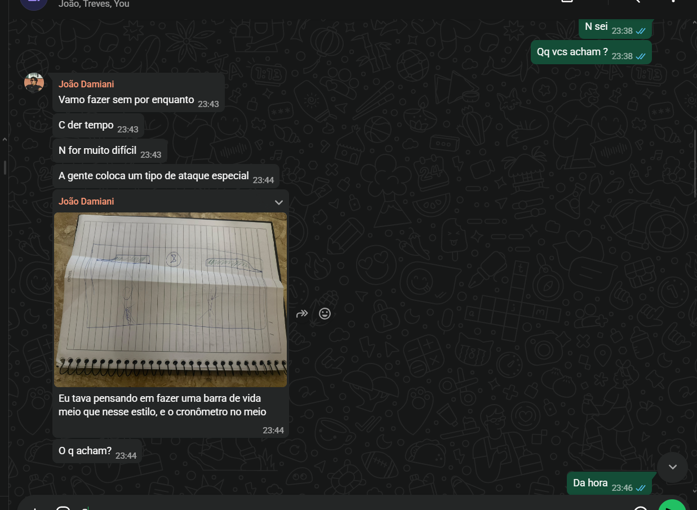
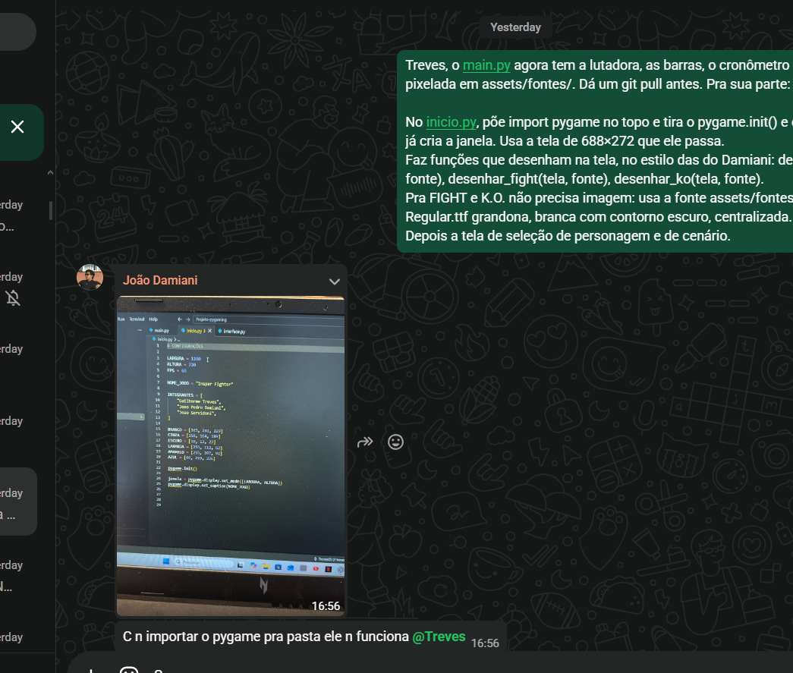
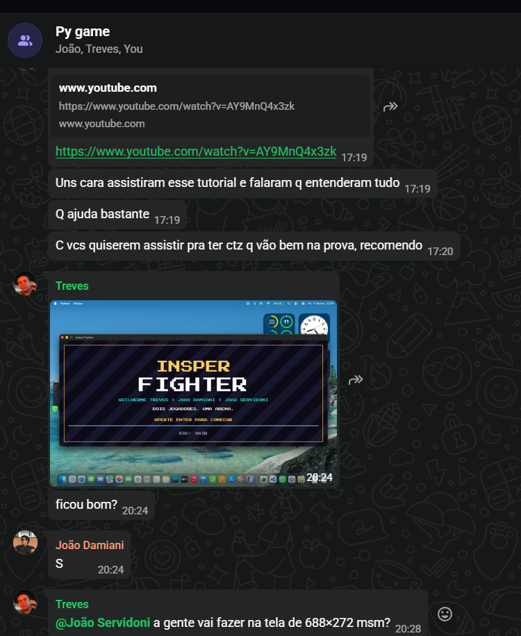

# Pasta de design

Esta pasta existe porque a rubrica do projeto dá **25% da nota** para "atuar em
equipe", e lista como evidência: *"rascunhos de design e sprites"*.

Coloquem aqui, e commitem:

- fotos dos rascunhos no papel (personagens, telas, layout da interface)
- prints de discussões do grupo sobre mecânica
- esboços das telas: início, luta, vitória
- estudos de personagem antes da versão final do sprite

Foto de caderno tirada com o celular conta. Não precisa ser bonito — precisa
mostrar que as decisões foram discutidas pelo grupo.

Cada integrante commita os próprios rascunhos, da própria conta do Git. O
histórico de quem commitou o quê é o que o professor olha.

## O que já tem aqui

**Rascunho da barra de vida (Damiani).** Desenho no caderno com as duas barras
no topo e o cronômetro no meio. Foi a base do `interface.py`.

**Discussão do HUD no grupo.** O Damiani manda o rascunho e o grupo aprova. Na
mesma conversa fica decidido deixar o ataque especial para depois, "se der tempo".

**Divisão de tarefas.** Mensagem para o Treves sobre o que ele faria no
`inicio.py`: as funções de desenho das telas no mesmo estilo das do Damiani e a
tela de 688×272. Logo abaixo, o Damiani mostra o primeiro `inicio.py` e avisa
que sem o `import pygame` o arquivo não roda.

**Primeira tela inicial (Treves).** O Treves manda o print da tela de início
rodando ("ficou bom?") e o Damiani aprova. Em seguida vem a pergunta se a tela
ficaria mesmo em 688×272. Na mesma conversa aparece o tutorial de PyGame que
o grupo indicou para estudar para a prova.

